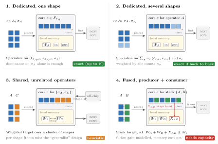

# Pareto-optimal accelerators by schedule optimization: problem formulation

This note states the problem the schedule optimization solves, from scratch. It is meant as the reference the
implementation is checked against: what is decided, what is an input, what each objective counts, and what is
deliberately left out.

**Goal.** For a given tiled workload, find the accelerators that are Pareto-optimal in **(latency, energy, area)**,
each together with its schedule. An accelerator is a set of cores, possibly several copies of the same design,
plus the links between them. The schedule says which core every piece of work runs on and when.

The note is organized as follows:

1. The pipeline, and what happens outside the optimization.
2. Inputs and notation.
3. Step 1: core candidates, one Pareto front per tile shape class, and the cases where that is not enough.
4. Step 2: cross-evaluation of every candidate on every shape class.
5. Step 3: the system model (decisions, constraints, objectives).
6. Pareto front extraction by epsilon-constraint.
7. Re-measurement in Stream.
8. Hyperparameters and model size.
9. Scope: what is modelled, what is not, open points.
10. Implementation: the CP-SAT and Gurobi stages.

---

## 1. Pipeline

```
tiling (searched outside)
  └─> tiled workload: tile DAG, tile shape classes
        └─> Step 1: per shape class, Pareto front of core designs (fixed budget)
              └─> Step 2: cross-evaluation matrix  (shape class x candidate design)
                    └─> Step 3: system model, solved by epsilon-constraint
                          └─> re-measurement of every distinct solution in Stream
                                └─> measured Pareto front (latency, energy, area)
```

- **The tiling is not decided here.** An outer search (the tiling GA) proposes a tiling for every operator,
  runs the steps below on it, and scores it by the hypervolume of the measured front. This note only covers what
  happens for **one fixed tiling**.
- **There is no intra-core/inter-core distinction.** The tiling only says how each operator is cut into tiles.
  Whether tiles of one operator run on one core or are spread over several is a *placement* decision, made in
  Step 3. Spatial parallelism inside an operator is therefore an outcome of the optimization, not an input.

---

## 2. Inputs and notation

| Symbol | Meaning |
|---|---|
| $\mathcal{O}$ | operators (layers) of the workload |
| $\mathcal{T}$, $\mathcal{T}_o$ | tiles of the tiled workload, and the tiles of operator $o$ in tile order |
| $E \subseteq \mathcal{T}\times\mathcal{T}$ | tile dependencies; $b_{tu}$ bits are sent along edge $(t,u)$ |
| $\sigma(t) \in \Sigma$ | shape class of tile $t$: tiles with the same shape have the same cost on any core |
| $\mathcal{D}$ | core design space (array size, dataflow, memory hierarchy) |
| $\ell_{\sigma,d},\ e_{\sigma,d}$ | latency and energy of one tile of shape class $\sigma$ on design $d$, from the cost model (ZigZag) |
| $a_d$ | area of design $d$ |
| $\mathcal{W}$ | width levels a link can take (bits/cycle) |
| $\beta$ | off-chip bus bandwidth (bits/cycle) |
| $\lambda_{\text{ic}}(\cdot)$ | interconnect area model: routers and wires as a function of link count and widths |

---

## 3. Step 1: core candidates, one front per shape class

For every **shape class** $\sigma \in \Sigma$ (not every tile: tiles of one class are identical to the cost
model), explore $\mathcal{D}$ on that shape alone and keep a front $F_\sigma \subseteq \mathcal{D}$ that is
Pareto-optimal in $(\ell_{\sigma,d}, e_{\sigma,d}, a_d)$.

- **Fixed budget.** At most $K$ designs per class ($K = 10$ by default). The exploration stops at the budget, so
  a front may hold fewer than $K$ designs, and the designs it keeps can be spread unevenly along the front. The
  budget is not a target number of points.
- The candidate pool is $\mathcal{C} = \bigcup_\sigma F_\sigma$, so $|\mathcal{C}| \le K\,|\Sigma|$ (fewer when
  fronts share designs). Section 3.1 extends it with designs specialized for cores that host more than one
  shape class.

### 3.1 Cases of core specialization

Which designs are worth exploring depends on what a core ends up hosting in Step 3. Four cases cover it. They
are shown in the figure below.



**When a per-tile front is enough.** Fix the placement and the order of the tasks on each core. Then every
objective is non-decreasing in each core's costs:

- the makespan of a schedule with precedences is non-decreasing in every task duration;
- energy is a sum of tile energies;
- area is a sum of core areas, and the wire area grows with each core's side length $\sqrt{a_c}$.

So if a core hosts the set of shape classes $\Sigma_p$, design $c$ is never needed on it when some design $c'$
satisfies

$$
\ell_{\sigma,c'} \le \ell_{\sigma,c},\quad e_{\sigma,c'} \le e_{\sigma,c} \quad \forall \sigma \in \Sigma_p,
\qquad a_{c'} \le a_c .
$$

When $\Sigma_p$ is a single class, this is dominance on that class alone, and $F_\sigma$ is exact. When $\Sigma_p$
holds several classes, dominance must hold on every class at once. The union of per-class fronts then misses
designs that are optimal on no single class but best on the mix.

| Case | What the core hosts | Specialization target | Explorations | Exact? |
|---|---|---|---|---|
| 1. Dedicated | tiles of one shape class; outputs are sent to another core | $(\ell_{\sigma,c},\ e_{\sigma,c},\ a_c)$ | $\lvert\Sigma\rvert$ | yes, up to $K$ |
| 2. Dedicated, several shapes | tiles of one operator with several shape classes (boundary or padded tiles) | $\big(\sum_\sigma n_\sigma \ell_{\sigma,c},\ \sum_\sigma n_\sigma e_{\sigma,c},\ a_c\big)$ over the operator's classes | $\lvert\mathcal{O}\rvert$ | yes, when the core runs its tiles back to back |
| 3. Shared (time-multiplexed) | groups of unrelated operators taking turns; no data passed locally; weights reloaded on each switch | same weighted target over a cluster of similar shape classes | number of clusters | heuristic |
| 4. Fused | a producer and its consumer; the intermediate tensor stays local; several operands resident at once | weighted target over an operator stack, subject to $W_A + W_B + X_{AB} \le M_c$ | $O(\lvert\mathcal{O}\rvert\, m)$ for stacks up to length $m$ | only if capacity is in the system model |

Here $n_\sigma$ is the number of tiles of class $\sigma$ the core runs. The constraint in case 4 says that the
weights of both operators and the intermediate tiles $X_{AB}$ must fit in the core's memory $M_c$.

**Which sets to enumerate.** Enumerating every subset of shape classes is exponential, so only the plausible
ones are explored:

- **Case 2:** one exploration per operator that has more than one shape class.
- **Case 3:** shape classes are clustered by similarity, with one exploration per cluster.
- **Case 4:** operator stacks that are contiguous along the DAG, of length $2..m$.

Every design found is added to $\mathcal{C}$, and Step 2 cross-evaluates it like any other. Step 3 can still put
any design on any slot, so extra candidates can only improve the front. Their cost is a larger
$D = |\mathcal{C}|$ in the $y$ and $z$ variable families.

**Case 4 depends on memory capacity.** The system model already sees the benefit of fusion: a transfer costs
nothing when both groups share a core. It does not see the cost of fusion, a larger memory, because on-chip
capacity is out of scope (section 9). Without capacity in the model, Step 3 will put a fused pair on a small
per-tile design, and Stream will then penalize that choice with eviction and re-fetch. Fused designs pay off
only once the system model checks at least that the working set of the operators hosted on a slot fits the
slot's design.

## 4. Step 2: cross-evaluation

Every candidate is evaluated on every shape class:

$$
\ell_{\sigma,c},\ e_{\sigma,c}\quad \forall\, \sigma \in \Sigma,\ c \in \mathcal{C}, \qquad a_c\quad \forall c.
$$

This takes $|\Sigma|\cdot|\mathcal{C}|$ cost-model evaluations. A design that cannot run a shape class gets no
entry, and is then not allowed to host tiles of that class.

The memory hierarchy of each core is part of its design. All memory levels, including off-chip accesses, are
inside the per-tile cost model, so $e_{\sigma,c}$ already counts the energy of every memory access. Step 3 adds
only what the cost model of a single tile cannot see: contention on links and on the off-chip bus.

---

## 5. Step 3: the system model

### 5.1 Placement units and tasks

- **Group of tiles (unit of placement).** The tiles of each operator $o$ are split, in tile order, into
  $n_o$ contiguous groups. $\mathcal{G}$ is the set of all groups, and $o(g)$ is the operator of group $g$.
  All tiles of a group run on the same core. Groups of the same operator may share a core (run one after the
  other) or sit on different cores (run in parallel).
- **Task (unit of time).** Each group is cut further into tasks (chunks of consecutive tiles; with one tile per
  task this is the tile level). $\mathcal{K}_g$ is the set of tasks of group $g$; they run in chain order.
  A task depends on the tasks that hold its tiles' predecessors, so consecutive operators can overlap (layer
  fusion) at task granularity.

For a task $k$ and a design $c$:
$\ell_{k,c} = \sum_{t\in k} \ell_{\sigma(t),c}$, and $e_{g,c} = \sum_{t\in g} e_{\sigma(t),c}$ for a group $g$.

### 5.2 Hyperparameters

- $N$: the maximum number of cores. There are $N$ slots $p = 0..N-1$; a slot may stay unused.
- $n_o$: the number of groups of operator $o$. This is the most parallelism operator $o$ can get.
- The task granularity (tiles per task).

### 5.3 Decisions

| Variable | Domain | Meaning |
|---|---|---|
| $u_p$ | $\{0,1\}$ | slot $p$ holds a core |
| $y_{p,c}$ | $\{0,1\}$ | slot $p$ holds design $c$; one design can be used on several slots |
| $x_{g,p}$ | $\{0,1\}$ | group $g$ runs on slot $p$ |
| $S_k,\ C_k$ | $\mathbb{Z}_{\ge 0}$ | start and end of task $k$ |
| $\omega_{gh,w}$ | $\{0,1\}$ | width $w\in\mathcal{W}$ chosen for the traffic between groups $g,h$ |
| $L_{pq},\ B_{pq}$ | $\{0,1\}$, $\mathbb{Z}_{\ge 0}$ | a link exists between slots $p<q$, and its width |

### 5.4 Constraints

**Cores and designs.**

$$
\textstyle\sum_c y_{p,c} = u_p, \qquad u_{p+1} \le u_p, \qquad \sum_p x_{g,p} = 1, \qquad x_{g,p} \le u_p .
$$

Symmetry breaking: with groups indexed $0..|\mathcal{G}|-1$, group $i$ may only use slots
$p \le \min(i, N-1)$. Used slots come first.

**Design-dependent cost.** A task's duration follows the design of its group's slot. The product
$x_{g,p}\,y_{p,c}$ is linearized by $z_{g,p,c}$ ($z \le x$, $z \le y$, $z \ge x + y - 1$):

$$
C_k = S_k + \sum_{p,c} \ell_{k,c}\, z_{g(k),p,c}.
$$

**Precedences.** For two consecutive tasks $k \to k'$ of the same group, $S_{k'} \ge C_k$. For a dependency
$k \to k'$ between tasks of groups $g \ne h$, a transfer $r$ carries the bits of every tile edge between them
(see *Communication* below).

**One task at a time per core.** Two tasks $k, k'$ of different groups that are not already ordered by the
precedences must not overlap when their groups share a slot. With $q_{gh} = \sum_p x_{g,p}\,x_{h,p}$
(linearized per slot) and an ordering binary $o_{kk'}$:

$$
S_{k'} \ge C_k - M(1 - o_{kk'}) - M(1 - q_{gh}), \qquad
S_k \ge C_{k'} - M\,o_{kk'} - M(1 - q_{gh}).
$$

A solver with native interval scheduling (CP-SAT `NoOverlap` over optional intervals present iff $x_{g,p}$)
expresses the same thing without $o_{kk'}$ and big-M.

**Communication: correctly sized links.** The aim is for each pair of cores to get a link exactly as wide as
the schedule needs. A wider link costs interconnect area and shortens transfers.

- Every communicating group pair $(g,h)$ chooses one width: $\sum_w \omega_{gh,w} = 1$.
- A transfer $r$ from group $g$ to a task $k'$ of group $h$ carrying $b_r$ bits lasts
  $\tau_r \ge \sum_w \lceil b_r / w \rceil\, \omega_{gh,w} - M\,q_{gh}$, which is zero when both groups share a
  core.
- **Transfers overlap compute.** A transfer is an interval of its own on the link, not on either core, as in
  Stream, which moves data like a DMA. It starts after its producer task ends, $S_r \ge C_{\text{src}(r)}$, and
  the consumer waits for it, $S_{k'} \ge S_r + \tau_r$.
- **Just-in-time fetch.** As Stream fetches on demand, a transfer cannot end before the previous task of its
  consumer's group has ended.
- **Physical links.** Slots $p<q$ get a link as soon as two communicating groups sit on them, and the link is
  as wide as the widest pair it carries:

$$
L_{pq} \ge x_{g,p} + x_{h,q} - 1, \qquad
B_{pq} \ge \textstyle\sum_w w\,\omega_{gh,w} - W_{\max}\,(2 - x_{g,p} - x_{h,q}).
$$

**Off-chip bus.** This is included because it is what most often made measured points slower than predicted.
Every tensor loaded from off-chip (constant operands and graph inputs) crosses the shared bus once per core
that uses it. It is modelled at two levels of accuracy:

- **Aggregate:** $\text{latency} \ge \lceil \text{bits loaded} / \beta \rceil$, where the bits depend on the
  placement. A tensor shared by groups placed on one core is loaded once.
- **Timed:** each task that loads data waits for a load interval of $\lceil \text{bits}/\beta \rceil$ cycles.
  All load intervals share one bus (one at a time), are fetched just in time, and the aggregate bound is kept
  as a redundant cut.

### 5.5 Objectives

$$
\begin{aligned}
\text{latency} &= \max\big(\max_k C_k,\ \text{bus time}\big) && \text{single inference, makespan} \\
\text{energy}  &= \textstyle\sum_{g,p,c} e_{g,c}\, z_{g,p,c} && \text{compute and all memory levels, from the cost model} \\
\text{area}    &= \textstyle\sum_{p,c} a_c\, y_{p,c} \;+\; \lambda_{\text{ic}}(L, B) && \text{cores plus the interconnect only}
\end{aligned}
$$

- The **area** counts only the area added by the interconnect on top of the cores: routers and link wires.
  The router of a slot depends on its number of ports and their total width, which is a bilinear term,
  linearized with a one-hot of the slot's port count. Off-chip memory is excluded.
- The **energy** has no static/leakage term, so it does not depend on latency.

---

## 6. Pareto front extraction

The front is approximated by an **epsilon-constraint** sweep over the model, solved as an integer program:

1. **Extremes:** for each objective, minimize it, then minimize the other two lexicographically with the first
   fixed (tie-breaks). This gives the corners of the front and the range of each objective.
2. **Grid:** for each pair of epsilon bounds on two objectives, taken on a grid between the extremes, minimize
   the third.
3. Every distinct solution is kept, and dominated solutions are filtered out.

Each solve has a time limit. A solve that times out still contributes its best feasible solution, so the front
is exact only where the solver proved optimality. The status of each solve is logged.

## 7. Re-measurement in Stream

Every distinct solution is turned into a concrete accelerator: the slot designs, the links with their chosen
widths, and every tile pinned to its group's core. Optionally the model's tile order is passed as the
scheduling order. Stream then **re-measures** it. The measured (latency, energy, area) enters the Pareto
archive. The model's own prediction is kept next to it, as the evidence for how far the model can be trusted.
**The reported front is the measured one.**

---

## 8. Hyperparameters and model size

| Hyperparameter | Effect |
|---|---|
| $K$ (designs per shape class, default 10) | $|\mathcal{C}|$, the design dimension of every $y$ and $z$ |
| $N$ (maximum cores) | slots: the dominant factor of placement and link sizes |
| $n_o$ (groups per operator) | maximum parallelism per operator; sets $G = |\mathcal{G}|$ |
| tiles per task | time granularity: sets $T = \sum_g |\mathcal{K}_g|$ |
| $\mathcal{W}$ (width levels) | link sizing choices |
| epsilon grid levels, time limit per solve | front resolution and cost |

Sizes, with $D = |\mathcal{C}|$, $P$ the number of communicating group pairs, $R$ the number of transfers and
$Q \le T^2/2$ the number of task pairs not ordered by the precedences:

| Family | Binaries | Continuous / integer | Constraints |
|---|---|---|---|
| designs $y, u$ | $N(D+1)$ | | $O(N)$ |
| placement $x$ | $\le G N$ | | $G$ |
| design-dependent cost $z$ | $\le G N D$ | | $3GND$ |
| times $S, C$ | | $2T$ | $T$ + precedences |
| same-core $q$ (per slot) | $\le G^2 N / 2$ | | $O(G^2 N)$ |
| core disjunctions $o$ | $Q$ | | $2Q$ |
| link widths $\omega$ | $P\,|\mathcal{W}|$ | | $P$ |
| physical links $L, B$ | $N^2/2$ | $N^2/2$ | $O(P N^2)$ |
| transfers | | $2R$ | $O(R)$ |
| bus loads (timed) | $O(\text{loads}^2)$ | $2\cdot\text{loads}$ | $O(\text{loads}^2)$ |
| router linearization | $O(N^2)$ | $O(N)$ | $O(N^2)$ |

The dominant terms are the disjunctions $Q$ (quadratic in the number of tasks) and the link constraints
$P N^2$. Both are controlled by the hyperparameters: few tasks per group, a small $N$, and as few groups per
operator as the parallelism needs. With CP-SAT, $Q$ becomes $T\cdot N$ optional intervals instead.

---

## 9. Scope

**Modelled:**
- the number of cores (bounded by $N$), with repeated designs allowed;
- the design of each core;
- the placement of groups of tiles;
- task timing, with layer fusion at task granularity;
- link existence and width per core pair, with transfers that overlap compute;
- the off-chip bus;
- core and interconnect area;
- compute and memory energy.

**Not modelled, deliberately:**
- **On-chip memory capacity.** No capacity constraint and no eviction or re-fetch. Its effects only appear in
  the re-measurement. Left as is for now, which means fused designs (case 4 of section 3.1) are not yet
  worth exploring.
- **Static/leakage energy.**
- **Area outside the cores and the interconnect** (off-chip memory).
- **Steady-state throughput.** The objective is single-inference latency.

**Assumptions:**
- **A tile's cost does not depend on its context.** It is the same whatever ran before it on its core, so the
  cross-evaluation matrix is enough.
- **One clock for all cores.**
- **Non-preemptive tasks**, run in tile order within a group.

**Open points:**
- **Contention between group pairs sharing one physical link.** Each group pair is timed at its own width.
  Transfers of different pairs that land on the same slot link may overlap in the model, and only the
  re-measurement sees the contention.
- **How groups are cut.** Contiguous in tile order is the simplest choice. Cutting along a chosen loop
  dimension would make a parallel placement match a regular split of the operator, which is easier to read
  and to implement in hardware.
- **Coverage of the candidate pool.** Fronts built shape by shape can miss a "generalist" design that is optimal
  on no single shape but good across all of them. Cases 2 to 4 of section 3.1 address this, but how to cluster
  shape classes for case 3 is still open.
- **Loads shared by groups merged onto one core.** In the timed bus model, each group still issues its own
  load. The aggregate bound counts the tensor once.

---

## 10. Implementation

Step 3 and sections 6 and 7 are implemented twice in `stream/stages/generation/placement_optimization/`, as the
same model. The cross-evaluation matrix of Step 2 comes from `ScheduleExplorationStage`'s full-matrix warm-up, and
Step 1 is the existing per-tile core search.

| Module | Contents |
|---|---|
| `problem.py` | `PlacementProblem`: groups, tasks, per-design durations and energies, precedences, transfers, off-chip loads and interconnect coefficients, integer-scaled; `from_space` builds it from a `ScheduleSpace` |
| `cpsat_backend.py` | `CpSatBackend`: optional intervals with `NoOverlap` per slot, `AddMultiplicationEquality` for the router and wire products |
| `gurobi_backend.py` | `GurobiBackend`: the MILP of section 5.4, with `z = x y`, big-M disjunctions on the task pairs no precedence orders, and one-hot linearizations of the area products |
| `stage.py` | `PlacementSweep` (section 6) and the stages `CpSatPlacementOptimizationStage` and `GurobiPlacementOptimizationStage` (section 7) |

They are selected with `optimize_schedule_model(..., placement_solver="cpsat" | "gurobi", max_cores=N)` and run as
the `placement_cpsat` and `placement_gurobi` methods of `benchmarks/benchmark_schedule_optimization.py`. Each solve is logged to
`placement_<solver>/solves.csv` with its status, time, objective, bound and gap. `tests/test_placement_optimization.py`
checks that the two backends reach the same optimum of every objective on random instances covering every option.

Two choices differ from sections 5.1 and 5.4:

- **Groups are the inter-core slices of the tiling.** The outer tiling's inter-core factor of an operator plays the
  role of $n_o$. Groups of one layer may share a core (`allow_sibling_merge`, on by default). This reuses the schedule
  space and Stream's measurement as they are. Stream still shares a link's bandwidth `1 / n_o` ways between the
  transfers of a split layer, even when its groups are merged.
- **Transfers do not contend.** Each transfer only delays its consumer task by its duration at its group pair's
  chosen width, or not at all when both groups share a core. Contention on a link is left to the re-measurement.
  Without contention the just-in-time constraint is implied by the chain order, so it is not stated.

